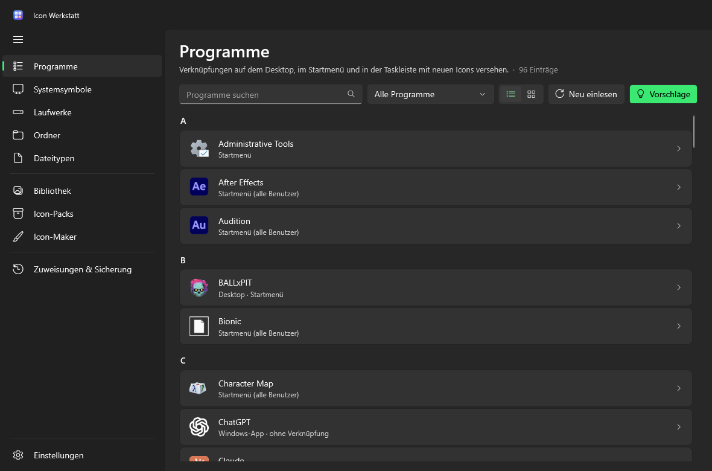
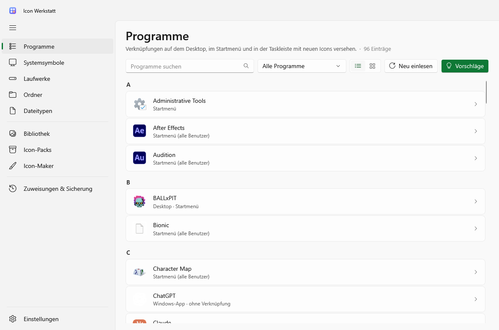
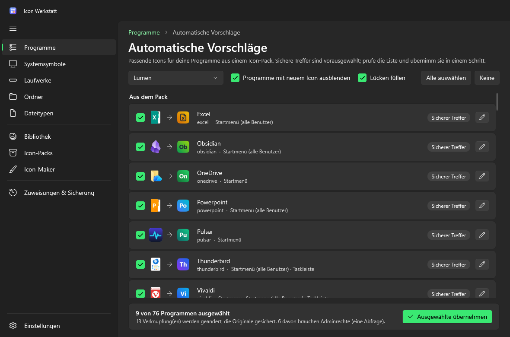
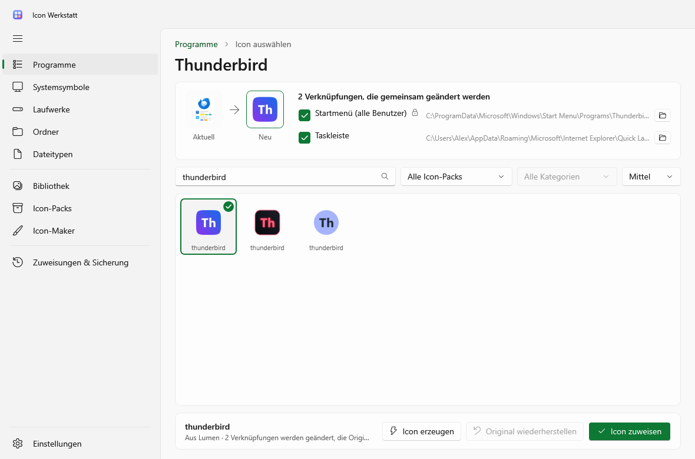
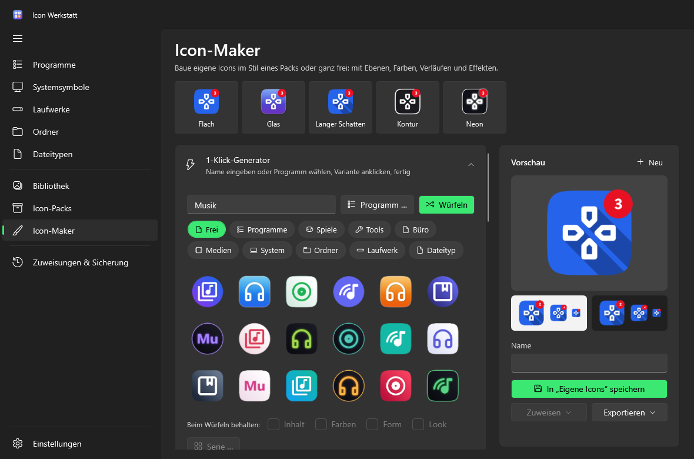
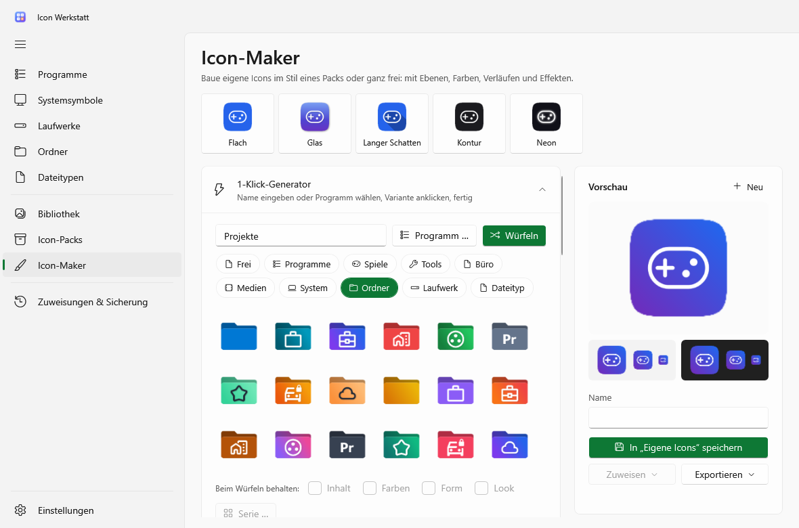
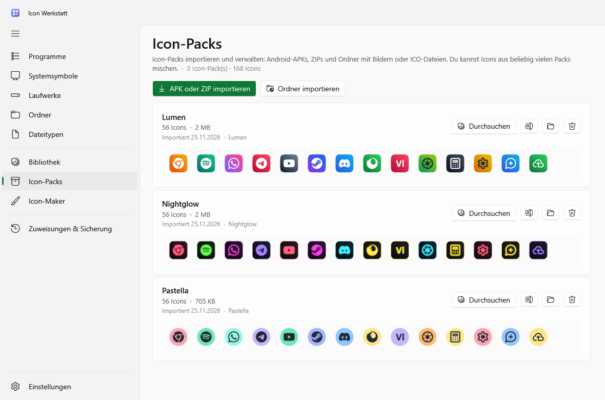
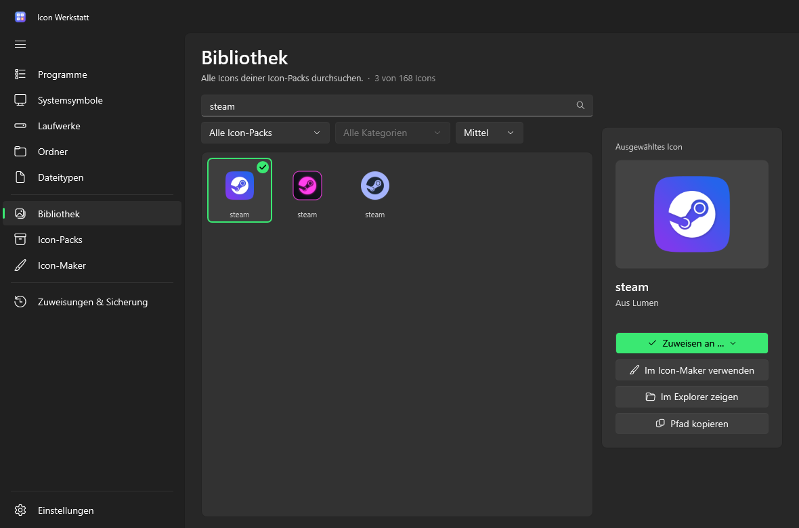

<p align="center">
  
</p>

<h1 align="center">Icon Werkstatt</h1>

<p align="center">
  Neue Icons für Windows 11: aus Android-Icon-Packs, Bilderordnern oder eigenen Entwürfen.<br>
  <a href="README.md">English</a> · <b>Deutsch</b>
</p>

<p align="center">
  <a href="https://github.com/RNYSVRN/Icon-Workshop/releases/latest"></a>
  
  <a href="LICENSE"></a>
</p>

<p align="center">
  
  
</p>

Android-Icon-Packs bringen tausende schön aufeinander abgestimmte Icons mit, nur Windows kann damit nichts anfangen. Die **Icon Werkstatt** importiert Icon-Packs (APK), ZIP-Dateien und Ordner mit Bildern oder ICO-Dateien und gibt deinen Programmen, Systemsymbolen, Laufwerken, Ordnern und Dateitypen einen einheitlichen neuen Look. Fehlt ein Icon, baust du es im Icon-Maker selbst oder lässt dir vom 1-Klick-Generator ein paar Dutzend vorschlagen. Alles nur für dein Benutzerkonto, ohne Administratorrechte, und jede Änderung lässt sich rückgängig machen.

## Download

**[⬇ Neuesten Installer herunterladen](https://github.com/RNYSVRN/Icon-Workshop/releases/latest)** (`Icon-Workshop-Setup-x.y.z.exe`)

Keine .NET-Installation nötig, alles ist enthalten. Voraussetzung: Windows 10 (1809) oder Windows 11, 64 Bit. Standardmäßig wird nur für dein Benutzerkonto installiert (ohne Adminabfrage); auf Wunsch für alle Benutzer.

> [!NOTE]
> **Windows warnt eventuell beim ersten Start.** Die Icon Werkstatt ist kostenlos und deshalb **nicht signiert** (eine Signatur kostet monatlich Geld).
> - *„Der Computer wurde durch Windows geschützt“* (SmartScreen): auf **Weitere Informationen** → **Trotzdem ausführen** klicken.
> - *„Eine Richtlinie zur Anwendungssteuerung hat diese Datei blockiert“* (Intelligente App-Steuerung): Sie lässt nur signierte Apps zu. Die Icon Werkstatt läuft dann nur mit ausgeschalteter Intelligenter App-Steuerung (*Windows-Sicherheit → App- & Browsersteuerung*). Achtung: Einmal ausgeschaltet, lässt sie sich nur durch Zurücksetzen von Windows wieder einschalten. Entscheide selbst.
>
> Der komplette Quellcode liegt in diesem Repository, du kannst ihn prüfen oder selbst bauen.

> [!IMPORTANT]
> **Es sind keine Icon-Packs enthalten.** Nutze Packs, die dir gehören (z. B. im Play Store gekauft), oder freie, und beachte deren Lizenz. Die Icon Werkstatt liest sie nur auf deinem PC.

## Funktionen

- **Eigene Icons mitbringen**
  - Android-Icon-Packs (`.apk`, `.apks`, `.xapk`), auch mit verschleierten Ressourcen und der App-Liste des Packs
  - ZIP-Dateien und Ordner mit PNG, ICO, WebP, JPG oder BMP; Unterordner werden zu Kategorien
  - Icons aus beliebig vielen Packs mischen; die Bibliothek durchsucht alle
- **Alles, was ein Icon hat**
  - **Programme**: Verknüpfungen auf dem Desktop, im Startmenü und in der Taskleiste, alle Verknüpfungen eines Programms auf einmal; Store-Apps; Programme ohne Verknüpfung bekommen eine eigene
  - **Systemsymbole** (Dieser PC, Papierkorb, Netzwerk …), **Laufwerke**, **Ordner** und **Dateitypen**
- **Automatische Vorschläge**: passende Icons für alle Programme aus einem Pack, sichere Treffer vorausgewählt, in einem Schritt übernommen. Programme, die das Pack nicht abdeckt, bekommen ein eigenes Icon im Stil des Packs
- **Icon-Maker**
  - Ebenen mit Symbolen, Text, Bildern, Programm-Icons und Badges; Formen, Verläufe, Schatten, Glanz
  - Der Stil eines Android-Packs (Kachel, Maske und Rahmen), damit eigene Icons dazu passen
  - **1-Klick-Generator**: Name rein, 18 fertige Varianten raus (Markenlogo, passendes Symbol, Initialen oder das Programm-Icon); würfeln und dabei Inhalt, Farben, Form oder Look behalten
  - **Kategorien** mit typischem Look und **Formen wie unter Windows**: Ordner mit Reiter, Laufwerk mit Leuchte, Seite mit Eselsohr und Endung
  - **Serie**: viele Icons auf einmal im selben Stil, z. B. für alle Projektordner
  - Freie Symbol-Schriften enthalten: Material Symbols, Tabler Icons, Font Awesome Free (durchsuchbar, auch auf Deutsch)
  - Export als PNG oder ICO
- **Sicher und umkehrbar**: Originale werden gesichert, *Wiederherstellen* bringt sie zurück, auch alle auf einmal; Export und Import aller Zuweisungen
- **Nach Programm-Updates**: Updates bringen oft das alte Icon zurück; *Erneut anwenden* (auf Wunsch automatisch bei der Anmeldung) behebt das
- **Spiele**: Steam- und Epic-Verknüpfungen werden erkannt, auch Steams bekannte leere Icons
- **Profile**: einen kompletten Look speichern und hin- und herwechseln
- **Explorer-Kontextmenü** (optional): Rechtsklick auf Verknüpfung, Ordner oder Laufwerk → *Icon ändern mit Icon Werkstatt*
- **Windows-11-Fluent-Design**: heller/dunkler Modus, deine Akzentfarbe, Mica, einklappbare Navigation
- **Deutsch und Englisch**, je nach Windows-Anzeigesprache
- **Privat**: keine Internetverbindung, keine Telemetrie, kein Konto

<p align="center">
  
  
</p>
<p align="center">
  
  
</p>
<p align="center">
  
  
</p>

<sub>Die Icon-Packs in den Screenshots („Lumen“, „Pastella“, „Nightglow“) wurden zur Veranschaulichung mit dem Generator der App erzeugt.</sub>

## Kommandozeile

```
IconWorkshop --open <Pfad>        Seite für eine Verknüpfung, einen Ordner oder ein Laufwerk öffnen (nutzt das Kontextmenü)
IconWorkshop --lang en|de         Sprache erzwingen
```

Läuft die App schon, wird `--open` an sie weitergegeben.

## Gut zu wissen

- **Wo die Daten liegen**: `%LocalAppData%\Icon-Workshop` enthält die Einstellungen, die importierten Packs, Sicherungen der Original-Icons und die ICO-Dateien, auf die deine Verknüpfungen zeigen. Den Pack-Ordner kannst du in den Einstellungen verschieben.
- **Deinstallieren** entfernt den Kontextmenü-Eintrag und die Prüfung bei der Anmeldung, behält aber den Datenordner, damit zugewiesene Icons weiter funktionieren. Willst du zurück zu den Original-Icons, vorher in der App *Alle wiederherstellen*; den Ordner löschen, um alles zu entfernen.
- **Verknüpfungen aller Benutzer** (z. B. im gemeinsamen Startmenü) brauchen zum Ändern Adminrechte; die Icon Werkstatt fragt einmal pro Aktion, alles andere läuft ohne.
- **Icons sehen noch alt aus?** Windows speichert Icons zwischen. *Zuweisungen & Sicherung → Aktualisieren* hilft meist, sonst dort den Icon-Cache leeren.
- **Grauer Rahmen um exportierte PNG/ICO-Dateien auf dem Desktop**: Das ist der Fotorahmen von Windows für Bild-Vorschauen; er lässt sich unter *Einstellungen → Allgemein → Optionen* ausblenden.

## Selbst bauen

Voraussetzungen: [.NET 10 SDK](https://dotnet.microsoft.com/download), optional [Inno Setup 6](https://jrsoftware.org/isdl.php) für den Installer.

```powershell
dotnet build src/IconWorkshop -c Release                        # App
powershell -ExecutionPolicy Bypass -File installer\build.ps1    # eigenständiger Build + Installer in dist\
dotnet run --project tools/ShortcutTest                         # Tests (arbeiten nur mit temporären Testdateien und -schlüsseln)
```

`tools/IconGen` zeichnet das App-Icon, `tools/PackProbe` importiert ein Pack zur Diagnose auf der Kommandozeile.

## Unterstützen

Die Icon Werkstatt ist kostenlos und bleibt es. Wenn sie deinen Desktop ein bisschen schöner macht, freue ich mich über einen Kaffee:

<a href="https://ko-fi.com/RNYSVRN"></a>

Ideen und Fehlermeldungen gerne als [Issue](https://github.com/RNYSVRN/Icon-Workshop/issues).

## Danksagungen

Im Icon-Maker enthaltene Symbol-Schriften:

- [Material Symbols](https://github.com/google/material-design-icons) von Google, Apache License 2.0
- [Tabler Icons](https://github.com/tabler/tabler-icons) von Paweł Kuna, MIT-Lizenz
- [Font Awesome Free](https://github.com/FortAwesome/Font-Awesome) von Fonticons, Schriften unter SIL OFL 1.1, Symbole unter CC BY 4.0. Markenlogos sind Marken ihrer jeweiligen Inhaber und dürfen nur gemäß deren Markenrichtlinien verwendet werden.

Die Lizenztexte sind in der App enthalten (*Einstellungen → Lizenzen & Datenschutz*) und unter `src/IconWorkshop/Assets/Fonts`.

## Lizenz

[MIT](LICENSE) © 2026 Ronny Severin.
