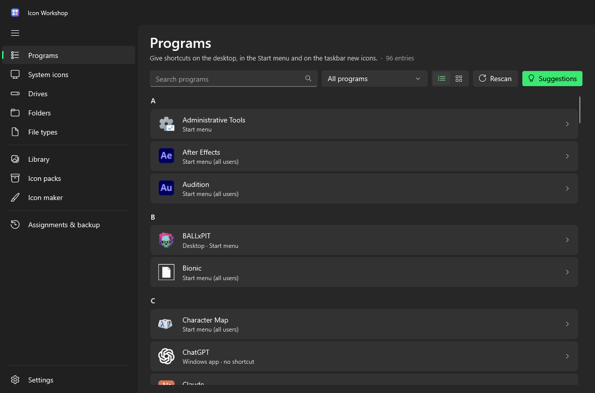
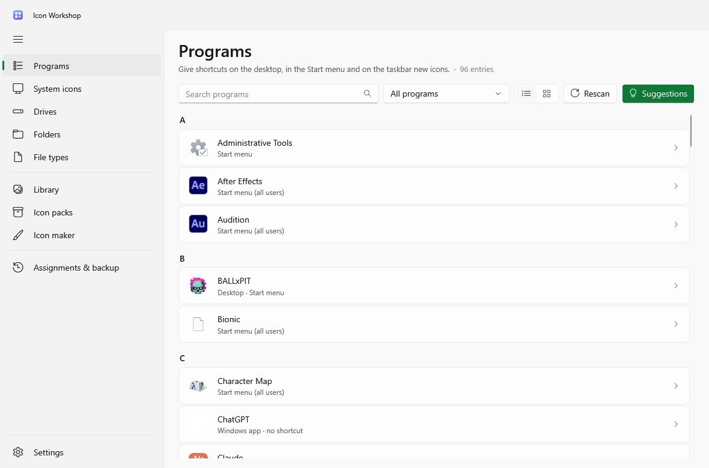
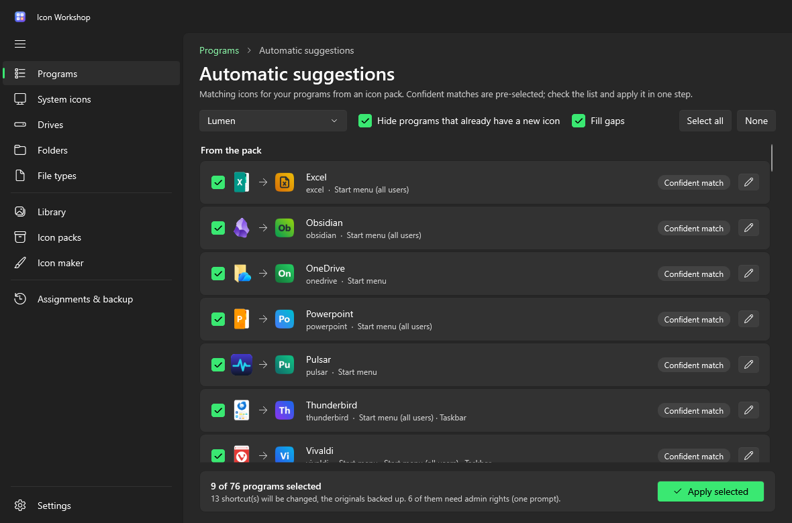
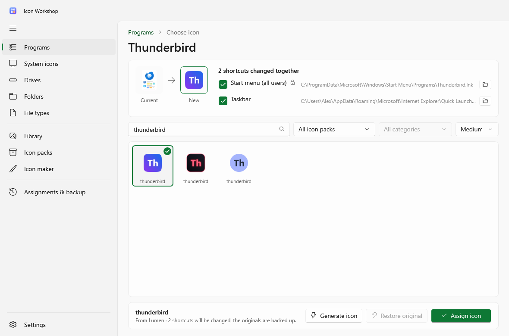
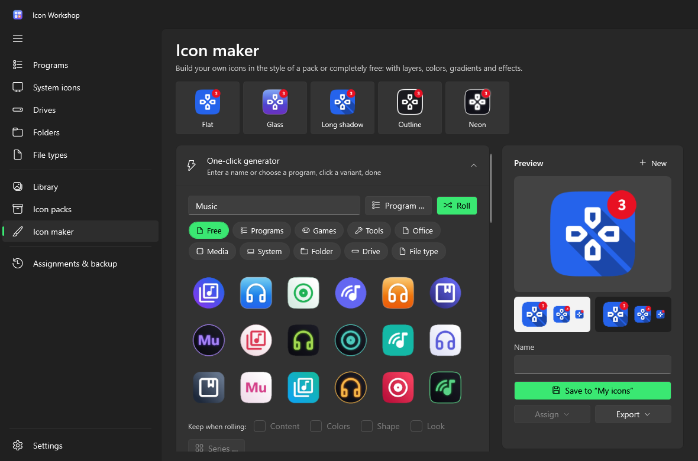
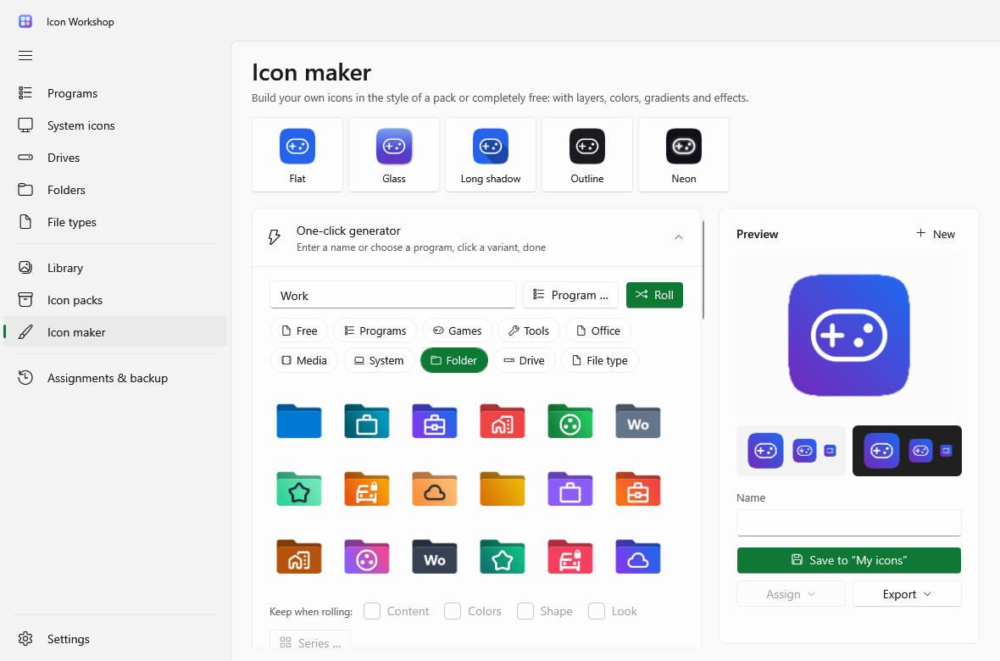
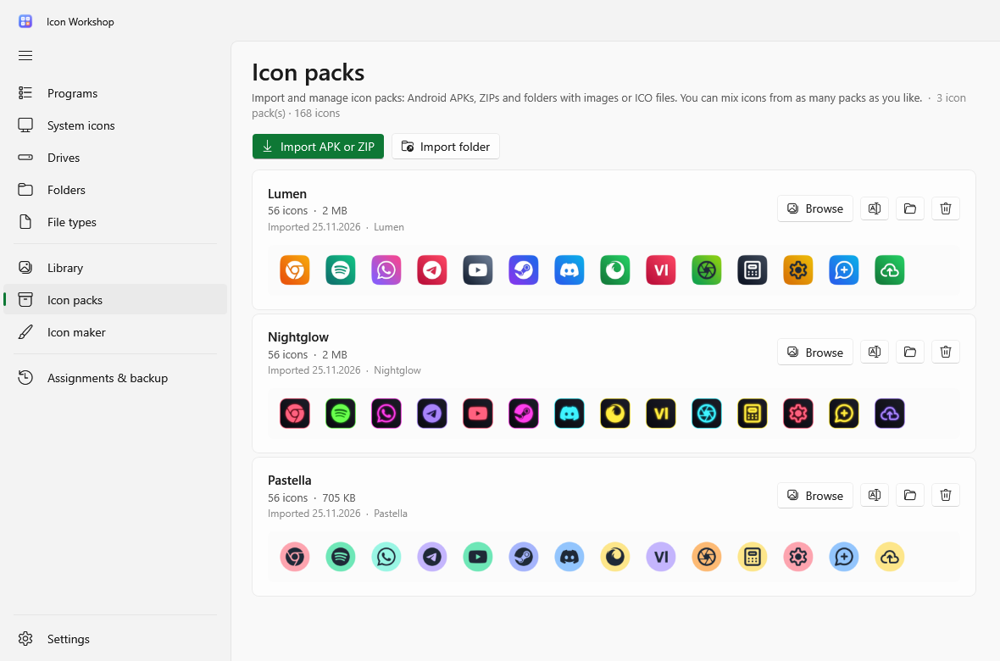
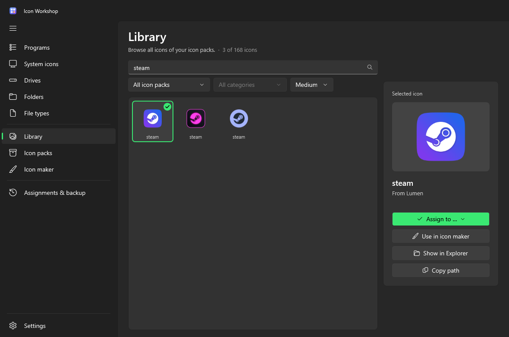

<p align="center">
  
</p>

<h1 align="center">Icon Workshop</h1>

<p align="center">
  Give Windows 11 new icons: from Android icon packs, image folders or your own designs.<br>
  <b>English</b> · <a href="README.de.md">Deutsch</a>
</p>

<p align="center">
  <a href="https://github.com/RNYSVRN/Icon-Workshop/releases/latest"></a>
  
  <a href="LICENSE"></a>
</p>

<p align="center">
  
  
</p>

Android icon packs come with thousands of beautifully matching icons, but Windows can't use them. **Icon Workshop** imports icon packs (APK), ZIP files and folders of images or ICO files and gives your programs, system icons, drives, folders and file types a consistent new look. Missing an icon? Build it yourself in the icon maker or let the one-click generator suggest a few dozen. Everything only for your user account, without admin rights, and every change can be undone.

## Download

**[⬇ Download the latest installer](https://github.com/RNYSVRN/Icon-Workshop/releases/latest)** (`Icon-Workshop-Setup-x.y.z.exe`)

No .NET installation needed, everything is included. Requires Windows 10 (1809) or Windows 11, 64-bit. By default it installs for your user account only (no admin prompt); you can choose to install for all users.

> [!NOTE]
> **Windows may warn you on first start.** Icon Workshop is free and therefore **not code-signed** (a signature costs money every month).
> - *“Windows protected your PC”* (SmartScreen): click **More info** → **Run anyway**.
> - *“An Application Control policy has blocked this file”* (Smart App Control): Smart App Control only allows signed apps. Icon Workshop then only runs with Smart App Control turned off (*Windows Security → App & browser control*). Note: once turned off, it can only be turned back on by resetting Windows. Decide for yourself.
>
> The complete source code is in this repository, so you can review it or build it yourself.

> [!IMPORTANT]
> **No icon packs are included.** Use packs you own (e.g. bought in the Play Store) or free ones, and respect their licenses. Icon Workshop only reads them on your PC.

## Features

- **Bring your own icons**
  - Android icon packs (`.apk`, `.apks`, `.xapk`), including obfuscated resources and the pack's app list
  - ZIP files and folders with PNG, ICO, WebP, JPG or BMP; subfolders become categories
  - Mix icons from as many packs as you like; the library searches all of them
- **Everything that has an icon**
  - **Programs**: shortcuts on the desktop, in the Start menu and on the taskbar, all shortcuts of a program at once; Store apps; programs without a shortcut get their own
  - **System icons** (This PC, Recycle Bin, Network …), **drives**, **folders** and **file types**
- **Automatic suggestions**: matching icons for all your programs from a pack, confident matches pre-selected, applied in one step. Programs the pack doesn't cover get their own icon in the pack's style
- **Icon maker**
  - Layers with symbols, text, images, program icons and badges; shapes, gradients, shadows, gloss
  - The style of an Android pack (its plate, mask and frame), so your own icons fit right in
  - **One-click generator**: a name in, 18 finished variants out (brand logo, matching symbol, initials or the program's icon); roll the dice and keep content, colors, shape or look
  - **Categories** with typical looks and **Windows-like shapes**: folder with tab, drive with light, page with folded corner and extension
  - **Series**: many icons in one style at once, e.g. for all your project folders
  - Free symbol fonts included: Material Symbols, Tabler Icons, Font Awesome Free (searchable, also in German)
  - Export as PNG or ICO
- **Safe and reversible**: originals are backed up, *Restore* puts them back, also all at once; export and import of all assignments
- **After program updates**: updates often bring back the old icon; *Re-apply* (optionally automatic at sign-in) fixes that
- **Games**: Steam and Epic shortcuts are recognized, including Steam's well-known blank icons
- **Profiles**: save a complete look and switch back and forth
- **Explorer context menu** (optional): right-click a shortcut, folder or drive → *Change icon with Icon Workshop*
- **Windows 11 Fluent design**: light/dark mode, your accent color, Mica, collapsible navigation
- **English and German**, following the Windows display language
- **Private**: no internet connection, no telemetry, no account

<p align="center">
  
  
</p>
<p align="center">
  
  
</p>
<p align="center">
  
  
</p>

<sub>The icon packs in the screenshots (“Lumen”, “Pastella”, “Nightglow”) were generated with the app's own generator for illustration.</sub>

## Command line

```
IconWorkshop --open <path>        open the page for a shortcut, folder or drive (used by the context menu)
IconWorkshop --lang en|de         force a language
```

If the app is already running, `--open` is passed on to it.

## Good to know

- **Where the data lives**: `%LocalAppData%\Icon-Workshop` holds the settings, the imported packs, backups of the original icons and the ICO files your shortcuts point to. The packs folder can be moved in the settings.
- **Uninstalling** removes the context menu entry and the sign-in check, but keeps the data folder, so assigned icons keep working. To go back to the original icons, use *Restore all* in the app before uninstalling; delete the folder to remove everything.
- **Shortcuts of all users** (e.g. in the shared Start menu) need admin rights to change; Icon Workshop asks once per action, everything else runs without.
- **Icons still look old?** Windows caches icons. *Assignments & backup → Refresh* usually helps, otherwise clear the icon cache there.
- **Gray frame around exported PNG/ICO files on the desktop**: that's Windows' photo frame for image thumbnails; it can be switched off under *Settings → General → Options*.

## Build from source

Requirements: [.NET 10 SDK](https://dotnet.microsoft.com/download), optionally [Inno Setup 6](https://jrsoftware.org/isdl.php) for the installer.

```powershell
dotnet build src/IconWorkshop -c Release                        # app
powershell -ExecutionPolicy Bypass -File installer\build.ps1    # self-contained build + installer in dist\
dotnet run --project tools/ShortcutTest                         # tests (only touch temporary test files and keys)
```

`tools/IconGen` draws the app icon, `tools/PackProbe` imports a pack on the command line for diagnostics.

## Support

Icon Workshop is free and stays that way. If it makes your desktop a little nicer, I'm happy about a coffee:

<a href="https://ko-fi.com/RNYSVRN"></a>

Ideas and bug reports are welcome as [issues](https://github.com/RNYSVRN/Icon-Workshop/issues).

## Credits

Symbol fonts included in the icon maker:

- [Material Symbols](https://github.com/google/material-design-icons) by Google, Apache License 2.0
- [Tabler Icons](https://github.com/tabler/tabler-icons) by Paweł Kuna, MIT License
- [Font Awesome Free](https://github.com/FortAwesome/Font-Awesome) by Fonticons, fonts under SIL OFL 1.1, icons under CC BY 4.0. Brand icons are trademarks of their respective owners and may only be used according to their brand guidelines.

The license texts are included in the app (*Settings → Licenses & privacy*) and in `src/IconWorkshop/Assets/Fonts`.

## License

[MIT](LICENSE) © 2026 Ronny Severin.
